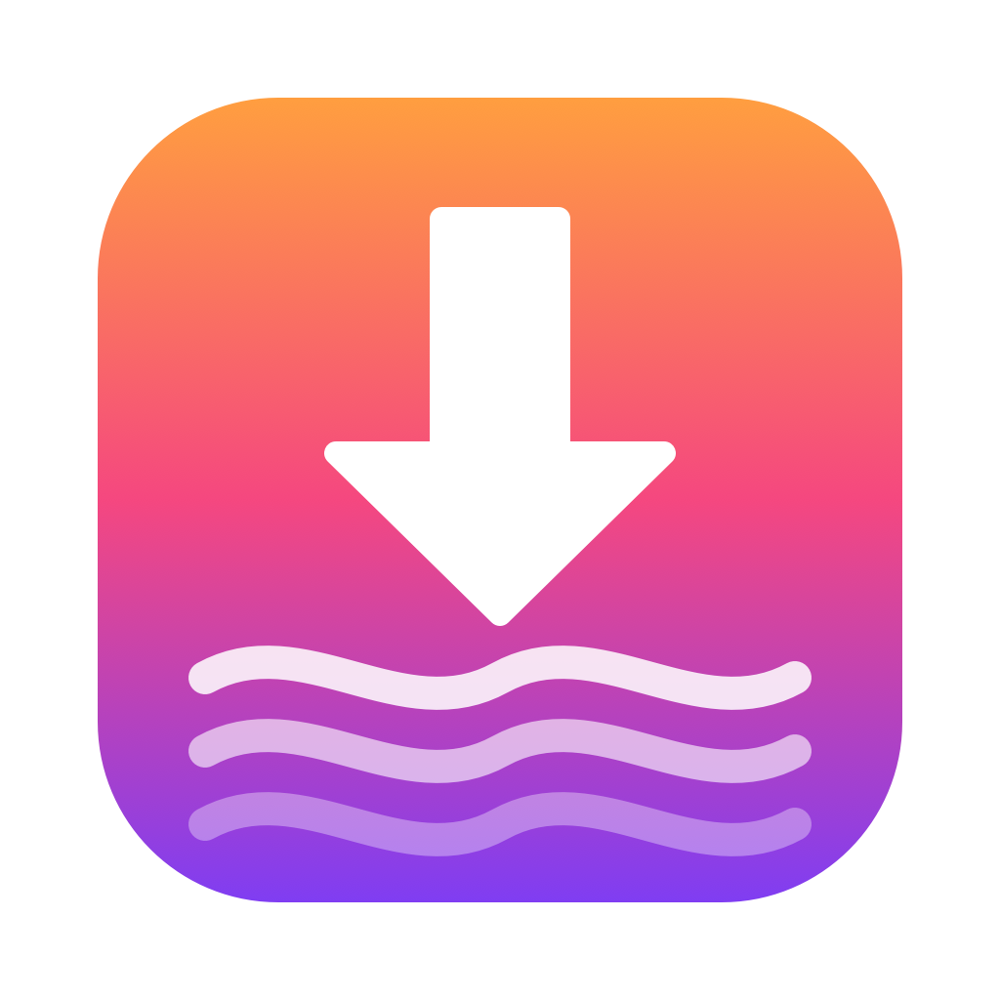
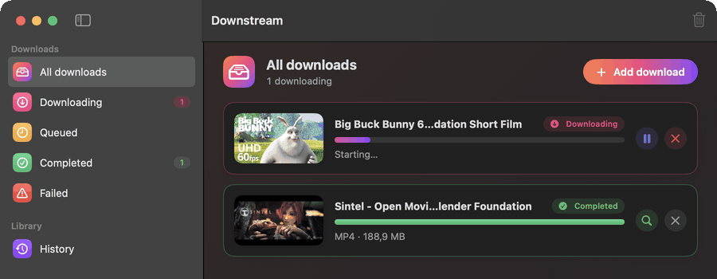
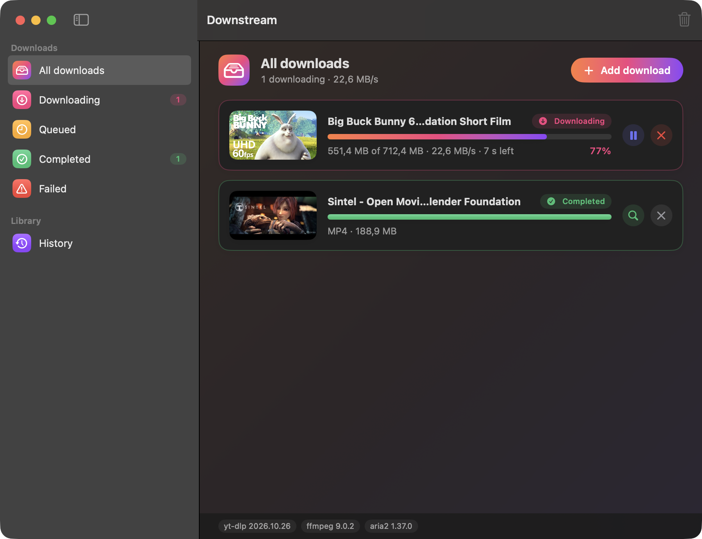
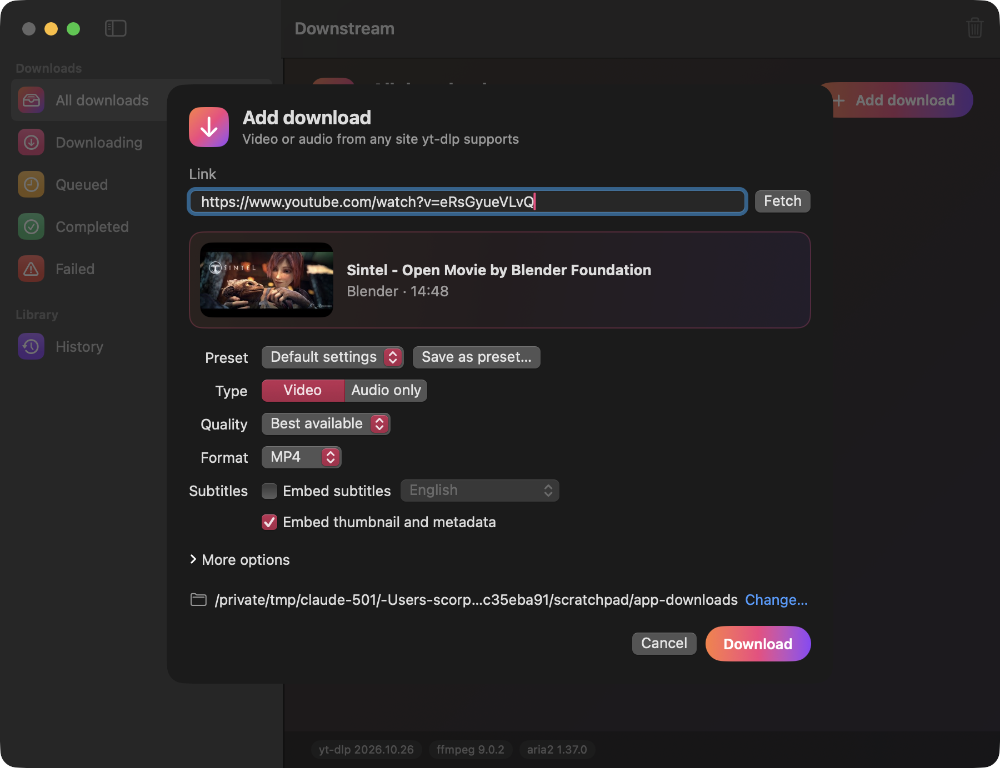
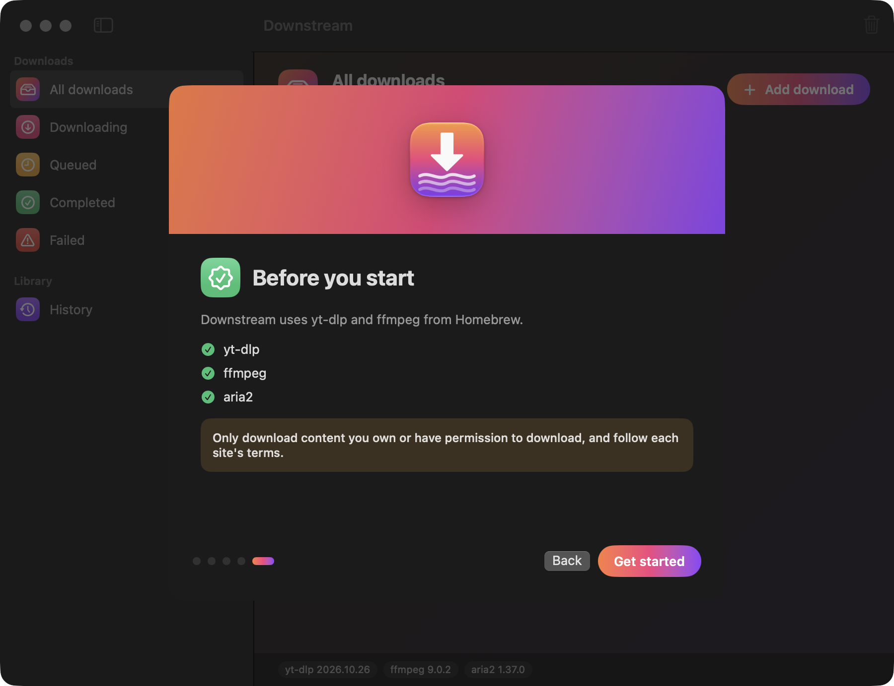
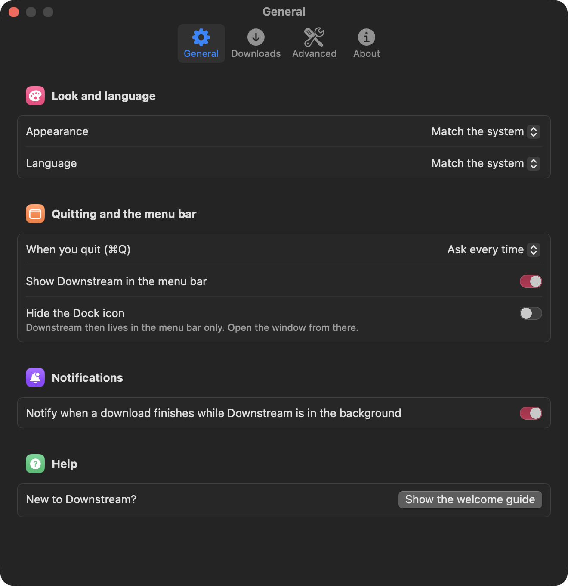

<p align="center"></p>

<h1 align="center">Downstream</h1>

<p align="center">
<b>Download video and audio on your Mac</b> from YouTube, Vimeo and 1,000+ other sites.<br>
Native, free and open source, powered by <a href="https://github.com/yt-dlp/yt-dlp">yt-dlp</a>.
</p>

<p align="center">
<a href="https://github.com/scorpionTaj/Downstream/releases/latest"><b>⬇︎ Download the latest version</b></a>
&nbsp;·&nbsp;
<a href="CHANGELOG.md">What's new</a>
&nbsp;·&nbsp;
<a href="https://github.com/scorpionTaj/Downstream/issues/new">Report a problem</a>
</p>

<p align="center">
<a href="https://github.com/scorpionTaj/Downstream/releases/latest"></a>
<a href="https://github.com/scorpionTaj/Downstream/actions/workflows/ci.yml"></a>


</p>

<p align="center"></p>

## Install

1. [Download `Downstream-<version>.dmg`](https://github.com/scorpionTaj/Downstream/releases/latest), open it and drag **Downstream** into **Applications**.
2. The first time, right-click Downstream › **Open** (the app isn't notarized yet, so macOS asks once).
3. Install the tools it uses, with [Homebrew](https://brew.sh):

   ```bash
   brew install yt-dlp ffmpeg aria2
   ```

   `aria2` is optional. Downstream tells you if anything is missing.

Downstream updates itself: you'll be offered new versions, with a progress bar and one click to relaunch.

## What it does

| | |
|---|---|
| **Video and audio** | Up to 4K in MP4, WebM or MKV, or audio only in MP3, M4A, Opus, FLAC or WAV |
| **Playlists** | Pick the videos you want from a list |
| **Extras** | Subtitles, thumbnails, metadata and chapters embedded in the file |
| **Queue** | Several downloads at once, with pause, resume, retry and cancel |
| **Menu bar** | Watch and control downloads, or download the copied link in one click |
| **History** | Every finished or failed download, ready to get again |
| **Power options** | SponsorBlock, browser cookies, aria2, speed limit, file name templates, presets |
| **Always current** | Downstream and yt-dlp keep themselves up to date |
| **Your language** | English, French and Arabic |

<p align="center">


</p>
<p align="center">


</p>

## How to use it

1. Copy a link in your browser.
2. In Downstream, click **Add download** (⌘N). The link is already filled in.
3. Choose video or audio, quality and format, then **Download**.

Shortcut: **⇧⌘V** downloads the copied link straight away with your default settings. Settings (⌘,) holds everything else.

## Build it yourself

You only need the Xcode Command Line Tools (`xcode-select --install`), not Xcode.

```bash
git clone https://github.com/scorpionTaj/Downstream.git && cd Downstream
swift run DownstreamChecks      # run the checks
./scripts/bundle.sh             # build build/Downstream.app
open build/Downstream.app
```

Releases are built by GitHub Actions: push a tag such as `v1.3.0` and the DMG is published with the matching section of [CHANGELOG.md](CHANGELOG.md) as release notes. More in [docs/DEVELOPMENT.md](docs/DEVELOPMENT.md).

## Credits

Downstream is a from-scratch app inspired by Parabolic and Macabolic, with none of their code. The heavy lifting is done by [yt-dlp](https://github.com/yt-dlp/yt-dlp), [ffmpeg](https://ffmpeg.org), [aria2](https://aria2.github.io) and [SponsorBlock](https://sponsor.ajay.app).

MIT license. Download only content you own or have permission to download.
